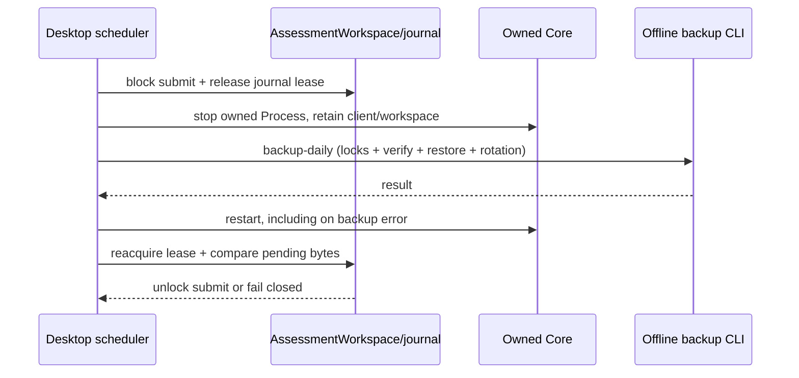

# Суточные State-копии

D-009.1.3a/b, develop. Реализованы запусковой сценарий BR-08 и периодическая проверка для собственного Core; установленная beta.1 не меняется. [Offline snapshot](offline-backup.md) остаётся единственным механизмом создания/проверки/восстановления.

## Использование

В macOS: «Профиль → Резервные копии → Выбрать каталог и включить…». Выбрать существующий локальный каталог, например ignored `var/backups` проекта, отдельно от папки профиля. Настройка запоминается локально, отдельно для beta/development preferences. Отключение не удаляет существующие копии. Вне UI:

```sh
LIFETRACKER_RUNTIME_ROOT="$PWD/var/beta-1" dotnet src/core/LifeTracker.Host/bin/Debug/net10.0/LifeTracker.Host.dll backup-daily "$PWD/var/backups"
```

При запуске существующего профиля desktop вызывает команду до запуска/подключения Core и до получения desktop journal lease. Пока идёт проверка, виден progress, запуск/повтор maintenance и обычный выход заблокированы. При отказе показано предупреждение, затем обычный запуск разрешён. Чужой Core или клиент не останавливается: offline lock откажет. Первое создание пустого профиля копию не создаёт; следующий запуск уже существующего профиля проверяет расписание.

До 09:00 Москвы команда ничего не создаёт. После 09:00 получает profile identity под offline locks и использует `<каталог>/<profile-guid>/daily-YYYY-MM-DD`. Одна completed копия на московскую дату; пропущенные дни не заполняются фиктивными снимками. Разные profile IDs разделены; восстановленный профиль с тем же ID относится к той же истории копий. Обычные ручные копии и предмиграционные данные не входят в этот managed подкаталог.

## Безопасность ротации и место

Под исключительной `.daily.lock` проверяется весь inventory каталога и каждая копия (manifest/hashes/schema/profile). Неизвестный файл, ссылка, будущая дата, повреждение или чужой profile ID дают отказ. Ничего из этого автоматически не удаляется. Остаток staging/restore-check после аварийного выключения требует отдельного inspection, не выдаётся за completed.

После preflight создаётся новая копия, проходит verify и restore rehearsal в отдельный временный каталог с проверкой схемы/integrity/profile. Лишь затем удаляются лишние completed суточные копии, остаются семь последних. Перед удалением каждый старый снимок снова проверяется. При повторе после публикации сегодняшней копии, но до ротации, restore rehearsal и ротация возобновляются. Это проверка восстановления хранилища, не полный UI/app smoke.

Стартовый бюджет **2 000 000 000 байт на managed каталог одного профиля**, запас свободного места **256 МиБ**. Оценка пикового дополнительного места — `2 × сумма размеров файлов исходного State-профиля + 4 МиБ`; WAL учитывается консервативно. Проверяются текущий объём копий плюс пик, доступное место тома каталога и temp (verify использует disposable копию). До проверки существующих DB проверяется место для temp validation. Старые копии не удаляются заранее ради освобождения места. При нехватке отказ; увеличение лимита/сокращение истории не делаются молча.

2 ГБ — локальный guard этого пакета, не измерение всего footprint: общий лимит 10/20 ГБ включает все профили, bundle, модели, данные и кэш. Общий inventory/budget gate ещё открыт. Free-space preflight не резервирует место против других процессов; I/O-ошибки всё равно возможны, уже completed копии при неуспешном создании сохраняются.

## Границы приёмки

Реальные SQLite tests: Moscow 08:59/09:00, same-day dedup, отсутствие catch-up, восьмой снимок → семь, restore с записью, low-space/quota, corrupt/unknown/lease/links и повтор прерванной ротации. Disk probe проверяется с настоящим filesystem; недостаток места моделируется отдельным injected probe без заполнения диска. Test quota использует sparse synthetic file. Эти .NET tests включены и в macOS CI. Swift process integration вызывает CLI с реальным clock: до 09:00 допустим no-op; детерминированное расписание проверяется .NET clock fixtures.

Открыты: ручная UI/quit/progress/form acceptance, реальный OS sleep/wake, предмиграционные копии, общий footprint, полная RPO≤24h активной работы и RTO≤10min на 1GB. Наличие scheduler не закрывает измерительные gates. Обновление расписания/ротации здесь уточняет реализацию BR-08, не меняет полный R1 scope.

## Непрерывная работа собственного Core

DesktopSession хранит одну задачу polling независимо от видимости окна: tick раз в 60 секунд и после успешного wake probe. DailyBackupSchedule использует московскую дату/09:00, подавляет повторы успешного дня, после ошибки откладывает повтор минимум на 15 минут. Пропущенные дни не создают очередь исторических копий. После startup no-op до 09:00 день не помечается выполненным; используется время начала попытки, а не завершения процесса.

Tick допускается только для ready/owned Core, выбранного каталога, существующего workspace без активной отправки/загрузки истории/паузы. Флаг maintenanceBusy выставляется до первого await, поэтому повторные tick/wake не начинают второй цикл. Ожидающие условия проверяются снова на следующем tick, без принудительного прерывания запроса. Внешний Core автоматически не останавливается.



Открытая форма остаётся в том же view tree: runtime сохраняет client во время паузы, workspace не заменяется, savedCount не увеличивается. Редактирование формы возможно, отправка заблокирована. После возврата lease pending journal побайтно сравнивается с состоянием до паузы; чужая запись или занятый lease оставляют submit заблокированным с сообщением о перезапуске. Очистка или перезапись чужой pending-команды не выполняется.

Явный stop инвалидирует generation и не позволяет возродить Core после операции. Обычный quit заблокирован на время maintenance. При ошибке CLI выполняется попытка restart; если сам restart не удался, действует existing failed-state recovery, сохранность UI-черновика в этом случае не обещается. Force Quit/desktop orphan и непрерывная работа без запущенного desktop остаются открытыми сценариями. CLI не получил online bypass: всё ещё требует обе offline блокировки.

Evidence: deterministic schedule boundary/dedup/retry; journal write blocking, lease conflict и изменившиеся bytes; in-flight submit не освобождает lease; stop-vs-pause не перезапускает Core; external host не приостанавливается. Live Swift/packaged-Core проверяет ту же workspace identity, pending receipt replay без дубля и restart после отказа backup. Это не автоматизация SwiftUI-кликов и не target RPO/energy benchmark.
