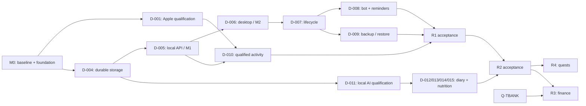

# Управленческий план разработки

Версия 1.0, 20 ноября 2026 года. Основание — [ТЗ](../requirements/specification.md), [backlog D-001–024](baseline/implementation-plan.md), [qualification register](../integrations/qualification.md) и [release acceptance](../quality/release-acceptance.md). План организует исполнение baseline1.0 и не меняет его scope. Новые даты, оценки и решения о scope версионируются отдельно от исходного baseline.

## 1. Управленческая оценка

Сильная сторона проекта — зафиксированные бизнес-правила, контракты и границы модулей. Главные угрозы срокам — неподтверждённые интеграции, качество локального ИИ и объём эксплуатационных сценариев. Дополнительное расширение проектной документации без проверки этих рисков сейчас менее ценно, чем законченная вертикаль с реальным хранением и установкой.

Проектирование завершено как baseline; техническая осуществимость отдельных возможностей ещё не доказана. Количество диаграмм, коммитов или тестов не является процентом готовности продукта. Проверенный domain State не означает готовность пользовательского сценария или сохранность данных при сбое.

Контрольная точка на начало плана: PR #1 и #2 слиты в develop; реализованы .NET State Domain/Application и Swift library; 34 .NET, 5 Swift и 25 tooling/schema tests пройдены. В PR #2 успешны оба workflow: [Product checks](https://github.com/Kori-Tamashi/LifeTracker/actions/runs/44623911931), [Project checks](https://github.com/Kori-Tamashi/LifeTracker/actions/runs/44623912015). UI, production storage, local host, restore и установочный пакет отсутствуют. D-002/D-003 закрыты только в пределах среза PR #2; полная матрица приёмки не объявляется выполненной.

## 2. Результаты и границы этапов

| Веха | Проверяемый результат | Допуск / зависимость | Что не обещается |
| --- | --- | --- | --- |
| M0 — baseline и фундамент | Документы, слои, вычисление состояния, Swift contract library, CI | PR #1/#2: выполнен фундамент | Пользовательская готовность R1 |
| M1 — сохранённая оценка | Запись через API, чтение после перезапуска, новая ревизия без потери старой | D-004 + D-005; real-store contracts | Полный релиз, фон и бот |
| M2 — локальный персонаж | Устанавливаемое окно, unknown/stale, быстрый ввод, история | M1 + D-006; synthetic UI/E2E | Готовность всех R1 gates |
| M3 — эксплуатационная готовность | Фон, sleep/wake, Telegram, уведомления, backup/restore | D-007/008/009 + квалифицированный activity adapter | Обход неуспешной qualification |
| R1 — персонаж | Все согласованные пути персонажа и R1 acceptance | D-001…010, полный gate; либо утверждённое изменение scope | Автоматический выпуск урезанного варианта |
| R2 — дневник и питание | Локальная речь, память событий/людей, доказательства выводов, фото и дневник | D-011…015; качество, latency, RAM/disk и food-data gates | Замена локального ИИ облаком |
| R3 — финансы | Автоимпорт, reconciliation, бюджет, портфель и read-only расчёты | Q-TBANK + D-018…021 | Подмена полного банковского доступа одним Invest API |
| R4 — квесты | Автономные назначения, адаптация нагрузки, эффекты и восстановление | R2 + D-022…024 | Штрафы за технический сбой или отсутствие данных |

D-016 Health bridge — отдельная опциональная ветвь возможностей после API; не блокирует R1. Steam, изменение внешности, серверный хостинг и реальные банковские переводы не включаются в текущую очередь. Если R3 недоступен, после R2 продолжается R4 с явным capability manifest; нумерация версий отражает фактические выпуски.

M1/M2 — внутренние демонстрации из develop, не теги main и не публичные релизы. Релиз остаётся редким событием завершения этапа.

## 3. Ответственность и ресурсы

| Роль / ресурс | Ответственность | Ограничение |
| --- | --- | --- |
| Владелец продукта | Изменение целей/scope, принятие компромиссов, действия с устройством/аккаунтом, субъективная приёмка UX | Не требуется подтверждать каждую инженерную задачу |
| ИИ-исполнитель | Разработка, тесты, технический review, обновление плана и рисков, PR/merge/release после gates | Один основной пакет в работе; независимого человеческого review не предполагаем |
| Целевой Mac | Native integration/installation, energy/RAM/disk, локальный ИИ benchmark | Hosted CI не доказывает показатели целевого устройства |
| GitHub CI | Воспроизводимая чистая сборка и автоматические проверки на синтетике | Не даёт доступ к личному профилю; платные runner/сервисы не включаются |
| Устройства и внешние API | Доступ, подпись, entitlement, синхронизация | Внешнее ожидание учитывается отдельно от трудозатрат |

План не предполагает параллельных разработчиков или автономной работы между запусками чата. Один и тот же ИИ может выполнять роли аналитика, разработчика и проверяющего последовательно; это не независимое аудиторское заключение.

Денежное ограничение — 0 дополнительных платных инструментов, подписок и инфраструктуры. Оно не означает отсутствия стоимости времени, электричества и уже имеющихся устройств/доступа к ИИ. Новая платная зависимость требует изменения ограничений владельцем. Footprint продукта контролируется относительно baseline; build caches измеряются отдельно и не включаются скрыто в пользовательский bundle.

## 4. Ближайшая очередь: подробная WBS

S/M/L — относительная инженерная сложность и неопределённость, не дни или story points для суммирования. L перед стартом делится на проверяемые дочерние задачи. Review, тесты и документация входят в результат каждой строки; не откладываются на конец этапа.

| Пакет | Результат / доказательство | Зависит от | Размер | Состояние |
| --- | --- | --- | --- | --- |
| PM-01 | Текущие GitFlow/CI rules сверены с remote; определить доступность обязательных checks/rulesets, записать ограничения | M0 | S | audit выполнен; server rules pending |
| D-001.1 | Матрица официальных способов получения aggregate/category Screen Time; права, регион, установка, ссылки и pass/fail | M0 | M | документальная часть выполнена |
| D-001.2 | Минимальный эксперимент на целевом устройстве или конкретный недостающий prerequisite; обезличенный отчёт | D-001.1 | M | awaiting provisioning prerequisite |
| D-004.1 | SQLite/EF runtime qualification, минимальная миграция Profile/State/revisions, новая база открывается | M0 | M | реализация D-004.1; см. progress |
| D-004.2 | Атомарный batch + receipt, profile scope, idempotency; общие repository contracts на реальном SQLite | D-004.1 | M | реализация; shared contracts |
| D-004.3 | Append revision, optimistic conflict, concurrent retry, rollback и отмена без частичной записи | D-004.2 | M | реализация; rollback/concurrency tests |
| D-004.4 | Минимальные durable inbox/outbox, claim/fencing/retry; crash/restart fixtures | D-004.3 | L | storage primitives реализованы; host policies отдельно |
| D-005.1 | Local host, composition root, owner credential, health/capability status без личных данных | D-004.2 | M | реализован host |
| D-005.2 | Assessment create/revise/current/history; ошибки и receipts соответствуют OpenAPI | D-003 + D-004.3 + D-005.1 | M | реализован State transport |
| D-005.3 | M1 smoke: запись → restart → чтение → исправление → старая история; contract drift check | D-005.2 | M | local process smoke пройден |
| D-006.1 | SwiftUI unknown/current/stale, числа, источник, время; минимальная 2D-визуализация без выдуманных показателей | M1 | M | implemented; UI acceptance pending |
| D-006.2 | Быстрый частичный ввод и история/исправление; ошибки/повтор; первый synthetic UI test | D-006.1 | M | implemented; real host integration passed; UI E2E pending |
| D-006.3 | Локальный `.app`, повторяемая установка/обновление, M2 smoke; анимация не заменяет обязательный путь | D-006.2 | M | packaging implemented; visual/M2 acceptance pending Computer Use access |
| D-007.1 | Menu/autostart, закрытие окна, полная остановка, single instance/native service | M2 + D-004.4 | L | owned native lifecycle implemented; GUI/login approval and crash recovery qualification pending |
| D-007.2 | Sleep/wake, restart, отложенная очередь, no reminder storm, offline state | D-007.1 | M | connection revalidation implemented in develop; real sleep/UI, jobs/quota/orphan recovery pending |
| D-008.1 | Telegram pairing/owner, state read/write, offline/retry/dedup | D-005.3 + D-007.1 | M | planned |
| D-008.2 | Общий notification scheduler: quota/quiet/dedup, macOS+Telegram delivery | D-007.2 + D-008.1 | M | planned |
| D-009.1 | Consistent local snapshot, retention/disk, restore в чистый профиль; migration-failure recovery | D-004.4 + D-007.1 | L | partial: offline CLI; retention/disk/recovery open |
| D-009.2 | Readable export/delete и backup handling; операторская инструкция с синтетикой | D-009.1 | M | planned |
| D-010 | Activity adapter + provenance/stale/unavailable; соответствующие contract/UI tests | Q-APPLE-ACTIVITY pass + D-005.3 | L | gated |
| R1-AC | Полная R1 acceptance, package/license/manifest, update/restore, target Mac checks, release notes | Все обязательные пакеты R1 | L | gated |

`ready` означает наличие проектных входов, а не завершённую подготовку конкретного PR. Definition of Ready проверяется перед взятием задачи. Технически возможное начало D-005.1 до D-004.4 не создаёт дополнительный ресурс: при WIP=1 это выбор порядка, а не обещание параллельной работы.

Ближайшие исполнения: PM-01 → D-001.1/001.2 → D-004.1/004.2/004.3 → D-005.1/005.2/005.3. Затем довести M2 и эксплуатационные пакеты, не забыв D-004.4 до задач фона. Итоги Apple spike не должны блокировать независимую работу над M1; релизный gate при этом остаётся закрытым.

## 5. Зависимости и ограничивающие цепочки

Это сеть зависимостей, не рассчитанный CPM-график. Без калиброванных длительностей нельзя честно назвать математический критический путь и float. На R1 сейчас видны две потенциально ограничивающие цепочки: storage → API → UI → lifecycle → bot/restore и qualification Apple → activity adapter. При одном исполнителе ресурсная последовательность длиннее любого отдельного пути графа; «параллельность» на схеме не сокращает этот ресурсный предел.

После измерения длительностей пакетов рассчитываются earliest/latest finish и float; затем выполняется выравнивание единственного ресурса. Ожидание разрешений/подписи/ответа владельца моделируется отдельно. Нельзя сократить срок, одновременно назначив тому же исполнителю несколько задач на 100%.

## 6. Qualification до крупных вложений

| Исследование | Когда / предел первого цикла | Результат и решение |
| --- | --- | --- |
| Screen Time | Сразу; один документальный и один экспериментальный пакет | Pass с доказательством; либо unavailable/unqualified с точным prerequisite и запросом решения о R1, без скрытого собственного трекера |
| Локальный text/voice AI | После M1 как следующий риск-пакет перед масштабной разработкой дневника | Синтетический русский корпус, cold/warm latency, RAM/disk/license; только после pass строить полный RAG/voice путь |
| Фото/food data | До полного питания R2 | Vision uncertainty/portion/unknown и лицензированный набор; при fail требуется явное решение о scope |
| Т-Банк | До ledger/finance UI, предпочтительно короткое исследование после M1 | Матрица всех продуктов и автоматического read-only доступа; нет подтверждения — R3 остаётся отложенным |
| Health bridge | После M1 при доступности устройств | Реальная бесплатная установка, срок подписи/фон/batch dedup; отдельная capability |

Предел цикла — ограничение объёма исследования, не гарантия результата. После двух пакетов без доказательства не повторять те же действия: записать преграду и продолжить независимый пакет. Новое исследование открывается при новом источнике/условии. Действия, требующие устройства, аккаунта или решения о scope, не заменяются предположениями ИИ.

## 7. Работа по Kanban и GitFlow

Колонки: Backlog → Ready → In progress → Review/CI → Done; Blocked — отдельный флаг с причиной, владельцем следующего действия и условием разблокировки. WIP=1 для основной разработки, максимум один отдельный пакет ожидает внешнего события. Исследование или тестовая поломка входят в WIP; нельзя начинать много задач, называя их все «почти готовыми».

Карточка содержит ID D-nnn.x, один пользовательский/технический результат, requirement IDs и planned acceptance cases, входы/зависимости, размер, допущения, проверку результата, риск, evidence/PR и следующий шаг. У R1-пакетов state — FR-STA-001…008/TC-STA-*, UI — FR-CHR-*/TC-CHR-* и FR-UI-001/TC-UI-APP; notifications — FR-NOT-001/TC-NOT-*; operations — FR-LIFE-001, NFR и соответствующие случаи из [реестра](../requirements/registry.json). До PR используются точные существующие IDs, а не буквальные wildcard-ссылки.

Definition of Ready: понятен результат, есть входной контракт и доступные зависимости, синтетический способ проверки, нет нерешённого изменения scope. Большой пакет сначала декомпозируется. Definition of Done: реализован результат, meaningful tests и актуальные contracts/docs, publication review полного diff, зелёный CI на head SHA, PR слит в develop. Пакет с работающим кодом, но красным CI не закрывается.

Feature → PR → develop; release-ветка только после готовности этапа; full acceptance → main/tag → merge-back. Тестов fake недостаточно для закрытия production adapter. Правила branch protection после PM-01 либо включаются доступным способом, либо записывается ограничение и продолжает действовать проверка gates перед каждым merge. Наличие workflow само по себе не является серверным запретом bypass.

## 8. Оценка сроков и резерв

Календарный baseline пока не назначен: нет установленной частоты активной разработки и достаточной истории однотипных законченных пакетов. Срок «за N недель» сейчас будет предположением. S/M/L используется только для декомпозиции/очереди. Не переводить его в часы произвольным коэффициентом и не применять COCOMO к сгенерированным строкам кода как к факту производительности.

После первых пяти сопоставимых пакетов M1 фиксируются фактические active elapsed и blocked elapsed, cycle time, доля повторной работы; отсутствие замера записывается как unknown. Старые PR не получают выдуманные трудозатраты задним числом. Разработку мелких задач и многодневные внешние ожидания анализировать раздельно.

Для ближайшей вехи составляются оптимистичная/наиболее вероятная/пессимистичная оценки O/M/P по фактическим аналогам. PERT `(O + 4M + P) / 6` можно использовать как расчётную оценку при явно выбранных допущениях; это не P80/P90 и не доказательство срока. Сумма стандартных отклонений независимых работ не оправдана при общих рисках доступа/модели/устройства.

Прогноз по пропускной способности: `оставшиеся сопоставимые пакеты / принятые пакеты за активную неделю`, отдельно внешние ожидания. Публикуются диапазон, дата расчёта, объём и допущения. Только после этого назначается календарная веха. Буфер не расходуется на новые функции; начальный резерв до калибровки — один дополнительный цикл исправления/повторной приёмки каждой M-вехи, отдельно от feature scope. После фактов он заменяется измеренным резервом, без двойного учёта того же риска.

COCOMO/FP возможны как отдельный учебный или сравнительный расчёт с границей системы и входными параметрами. Для текущего проекта без калибровки AI-процесса они не используются для обязательств по срокам/стоимости. Перечень из 51 API operation не равен 51 функциональной точке.

## 9. Риски и реакции

Шкалы P/I: low/medium/high — экспертная приоритизация, не измеренные вероятности; статус всех технических рисков открыт до evidence. Владельцем реакции является ИИ, кроме явно указанных решений владельца продукта.

| ID | Риск; P / I | Сигнал | Предупреждение и реакция |
| --- | --- | --- | --- |
| RK-01 | Недоступность Apple aggregate/category; high/high | Нет подтверждённого разрешённого доступа | D-001 в начале; R1 gate закрыт, владелец решает scope; независимая M1 продолжается |
| RK-02 | Неполный автоматический банковский доступ; high/high | Только Invest либо нет стабильной истории операций | Не строить finance UI до Q-TBANK; отложить R3, продолжить R4 после R2 |
| RK-03 | Локальная модель не достигает качества/15s/footprint; high/high | Benchmark fails либо неподходящая лицензия | До RAG сравнить небольшие кандидаты; не отправлять данные в облако; scope/лимит меняет владелец |
| RK-04 | Потеря/двойная запись при сбое; medium/high | Contract/crash/restore failures | Atomic receipts, real-store concurrency tests, backups до личного профиля; блокировать релиз |
| RK-05 | Scope растёт быстрее готовых вертикалей; high/high | Новые компоненты без законченного M1/M2 | WIP=1, change log, новые идеи в backlog; не расширять текущую веху молча |
| RK-06 | Ложная готовность по unit tests; medium/high | Нет installation/UI/restore evidence | Раздельные gates, planned ≠ passed; milestone только по evidence |
| RK-07 | Утечка личных данных в public repo/CI; medium/high | Реальные fixtures/медиа/секреты | Publication policy, синтетика, reviewed diff; при обнаружении остановка публикации и отдельный incident plan |
| RK-08 | Нестабильная установка/фон/подпись; medium/high | Bundle не запускается после update или bridge истекает | Package smoke в M2; lifecycle до R1, optional Health не превращается в обязательство |
| RK-09 | CI доступен, но bypass не ограничен; medium/medium | Нет required-check ruleset | PM-01: проверить права/настройку; не считать workflow branch protection |
| RK-10 | Затяжные ожидания от владельца/устройства; medium/medium | Пакет не имеет доступного следующего действия | Записать требуемое действие один раз; взять независимый ready-пакет, прогноз сдвигать явно |

## 10. Контроль и изменение плана

В конце каждого активного рабочего сеанса: выполненный результат, PR/check SHA, следующий пакет, новые факты и blocked reason. После каждого закрытого пакета — фактическая длительность, причины доработки и обновление остатка. Каждые пять принятых пакетов или перед сменой M-вехи — пересмотр прогноза, рисков и ресурсов. Это правило рабочего процесса, не созданная автоматизация или фоновый таймер.

Показатели: принятые результаты/вехи, cycle/blocked time, rework, возраст WIP, escaped defects, состояние qualification gates, footprint и успешность restore. Не использовать число строк, коммитов или unit tests как KPI ценности. Coverage — quality gate из baseline, а не индикатор процента продукта. Earned value в деньгах пока не рассчитывается: нет денежного BAC/AC и временного baseline; при нулевых дополнительных платежах CPI неинформативен. Допустим простой burn-up принятых результатов, с явным изменением общего scope.

Любое новое требование проходит запись: причина → затронутые FR/AC/ADR → зависимости/ресурсы/риск → решение → новая версия плана. ИИ решает локальные реализации в рамках baseline; изменение приватности, платности, релизного объёма или подмена интеграции требует решения владельца. При росте прогноза ближайшей вехи более чем на 25% от первого калиброванного диапазона, повторном провале gate или обнаружении потери данных — внеочередной пересмотр. До появления диапазона процент не применяется.

## 11. Откуда взят подход

При подготовке просмотрены учебные материалы курса «Экономика программной инженерии»: лекция 2 (содержание, время, качество, ресурсы, риски), лабораторная 3 (выравнивание ресурса и критический путь), лабораторная 5 (контроль отклонений и освоенный объём), лабораторная 7 (FP/COCOMO II и границы применимости). Из них адаптированы методы; учебные бюджеты, штат, календарь и количественные примеры в план не перенесены. Файлы курса и их содержимое в репозиторий не копируются.

Размеры пакетов, порядок qualification, WIP и правила прогнозирования — инженерные решения для этого проекта, не вывод о гарантированных сроках из учебных моделей. Действующие правила реализации остаются в нормативном baseline и ссылочных документах.
